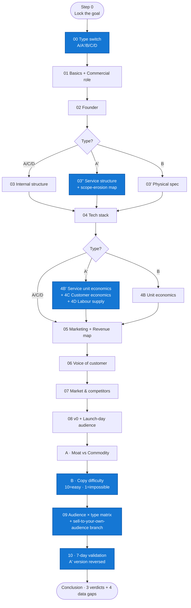

# creator-product-teardown

*Type switch · 5 branches · the service branch has 3 sub-types · 7-day action plan*

---

## Overview



**Highlighted in blue:** the official A' type + 3 sub-types · 03'' · 4B' · 4C · 4D · Layer 09 matrix · Layer 10 reversed for A' · R7-R9.

---

# LAYER 00 · PRODUCT TYPE SWITCH

| Type | Definition | Examples |
|---|---|---|
| **A** App / SaaS | The customer pays for the right to use software | Nexlev · 1of10 · vidIQ |
| **A'** Service / Agency | **The customer pays for a result made by people** | Replayed |
| **B** Physical product | The customer receives an object | Printed book · merch · supplements |
| **C** Digital / course | The customer receives files or access to content | PTYA · ebook |
| **D** Community | The customer pays for the right to belong | Skool group · paid Discord |

### A' sub-types (pick exactly 1)

| Sub-type | Billing | Main risk |
|---|---|---|
| **A'-1 Productised service** | Per delivered unit (per video, per article, per design) | Customer buys once and disappears |
| **A'-2 Subscription** | Monthly, with a quota | Going over quota erodes margin |
| **A'-3 Marketplace** | Takes a commission, does no work itself | Both sides meet, then leave the platform |

The sub-type decides what Layer 4C examines. **Replayed = A'-1.**

**Hybrid products** → pick the type by the main form of what the buyer receives, and write `Type: X + Y` in the header.

---

## General principles

### Output language
Write the report in the user's language (default English). Examples in this skill only
illustrate the writing style — for any other language translate every label, layer
title, note and footer. Write as a native speaker, never machine-translate.

No unexplained jargon. When writing for a non-specialist audience, explain terms like
pivot, moat, CAC, churn, MRR, LTV, POD, MOQ and unit economics in plain words the first
time they appear.

### Neutral
No bias toward your own product. Never write "good for my product" or "you have a home-market advantage".

### Images + logos
Google Favicons `?sz=256`, 16:9 screenshots cropped from the top, logo tint `rgba(255,255,255,.06)`.

### Inter dark-theme style
`--bg: #0f0f0f · --ink: #f1f1f1 · --neutral-border: #3a3a3a`. Accent colour only for red ✗ · green ✓ · score bars.

---

# LAYER SET FOR A' (Service / Agency)

| Layer | Content |
|---|---|
| 01 | Basics + Commercial role |
| **03''** | Service structure + **scope-erosion map** |
| 04 | Delivery tech stack |
| **4B'** | **Service unit economics — REQUIRED (R8)** |
| **4C** | **Customer economics — REQUIRED for A'-1 and A'-3** |
| **4D** | **Labour supply** |
| 05 | Marketing + Revenue map |
| 06, 07, 08 | As standard |
| 09 | **Audience × product-type matrix** (replaces the old decision tree) |
| 10 | **7 days, service version — reversed order** (D4 do it yourself first, hire later) |

---

## Layer 4B' — SERVICE unit economics (REQUIRED · R8)

> **This layer may NOT be switched off.** See R8.

### Why
A book is sold and done. A service pays the person doing the work on every order. For type A', unit economics **is** the business model, not an appendix.

An earlier Replayed report wrote "gross margin only estimated at 30-50%, no exact figure printed" and left it blank — **against the rules**. The data to compute it was in that very report.

### Step 1 — Define the delivered unit
One sentence, specific enough to order. E.g. *"1 finished video from 16-35 minutes of raw footage, with licensed music and basic motion graphics, thumbnail not included."*

Wrong unit → the whole table is wrong. Several different units → one column per unit.

### Step 2 — Required table

| Row | Notes |
|---|---|
| Price per unit | From the public price list |
| **Labour hours per unit** | Split by role: main worker / reviewer / customer support |
| Labour rate per hour | At the real market rate of the labour pool |
| Labour cost per unit | Hours × rate, summed over roles |
| Revision cost | Free revision quota × rate — **the biggest hidden cost** |
| Software, storage allocated | Spread over units per month |
| Payment and platform fees | |
| **Gross profit per unit** | Bold |
| **Gross margin %** | Bold |
| Monthly fixed costs | Manager, tools, marketing |
| **Break-even** | Units per month = fixed costs ÷ profit per unit |

### Step 3 — Scale ceiling (3 required rows)
- Units **one person** can do per month
- Units **the owner alone** can do before having to hire
- Revenue ceiling working alone = the two numbers above × price

Selling a service = selling time. Know where the ceiling is before starting.

### Step 4 — Working capital
Are workers paid before or after the customer pays? How many days apart? For services this is the most common reason a profitable business dies of running out of cash.

### Triangle check (REQUIRED)
Three numbers must agree: **price · labour hours · labour rate**.

If `hours × rate` exceeds **60% of the price** → print a warning:
> *"Unusually thin margin. Either the labour-hour estimate is wrong, or this model depends on cheaper labour than assumed."*

**Example that should have appeared in the Replayed report:** $349/video, editor rate $15-25/hour, a 20-minute raw video usually takes 8-12h → cost $120-300 against $349 revenue. A 34-86% ratio. At the bad end almost nothing is left. That number alone could flip the conclusion.

### Data rules
- Real numbers missing → **still render the table**, tag the whole table `estimate`, list assumptions below it. **Never leave it blank.**
- Sources for labour rates: the subject's own job posts on job boards → industry salary tables → rates offered on freelance marketplaces. State source + date.
- Hours per unit: from job descriptions, practitioners' posts, or an estimate by complexity.

---

## Layer 4C — Customer economics (REQUIRED for A'-1 and A'-3)

For A'-2 subscriptions → fold it into the subscription section.

### Why
Selling per unit with no subscription means finding customers again from scratch every month. For this model **the repeat-purchase rate is the survival metric**, more important than margin. The Replayed report had not one line on it even though the subject sells purely per video.

### Required fields

| Field | How to find |
|---|---|
| Do customers buy again, at what rate | Reviews mentioning "my nth order", testimonials mentioning tenure, customers repeating on the showcase page |
| Average units per customer per month | |
| Customer lifetime | Months before they stop |
| **Raw lifetime value** | Units/month × profit per unit × months |
| Share of revenue from returning customers | If it can be inferred |
| Cost to acquire one customer | If there are traces of ads or referral commissions |
| Retention mechanism | What brings customers back besides quality |

### Render rules
- No repeat-purchase data for an A'-1 model → **a warning is REQUIRED**:
> *"A per-unit model with an unknown repeat rate. This is the model's biggest risk: if customers buy only once, the whole acquisition cost must be recovered in a single order."*
- If profit per order is **less than** the estimated cost to acquire a customer → red warning: *"The model cannot sustain itself."*

---

## Layer 03'' — Service structure + scope-erosion map

Keep the package and process tables. Add 2 parts.

### Part A — Commitments and scope

| Field | Notes |
|---|---|
| Committed delivery time | A hard published commitment, or only vague wording |
| Penalty when late | Refund, discount, or nothing |
| Revision quota | Rounds or hours, then the price beyond that |
| Who checks quality before delivery | Worker self-check, a reviewer, or the customer finds out |
| Customer communication channel | |
| What is **not** included | An explicit list |

### Part B — Scope-erosion map

List where margin is silently eaten:

- Revisions beyond the quota
- Customers sending off-spec material that needs extra work
- Back-and-forth, meetings, explanations
- Unbilled extra work to keep the customer
- Redos because a new worker does not know the style yet

Each line: yes/no, based on which evidence in Layer 06.

**Replayed example:** the complaint clusters *"1-hour revision quota is too tight"* and *"quality varies between editors"* are direct evidence for the first 2 lines → real margin is below the paper margin.

---

## Layer 4D — Labour supply

For services, the source of workers is the supply chain. Without this layer real capacity cannot be judged.

| # | Field |
|---|---|
| 1 | Actual team size — if not public, say so and explain why it matters |
| 2 | Hiring source: which platform, which country |
| 3 | Rate paid to workers |
| 4 | Screening method, acceptance rate |
| 5 | Training time before real work |
| 6 | Full-time, part-time or per job |
| 7 | Worker retention mechanism |
| 8 | **Risk of workers taking customers away** — any restriction |
| 9 | Who bears the cost of a failed delivery |

### Rules
- **Item 1 is the most important metric for type A'** — it decides real delivery capacity. Cannot be traced → put it in the "data gaps" at the end of the report, **never skip it silently**.
- Item 8 is the specific risk of **A'-3 marketplaces**: once supply and demand have met, what reason do they have to keep going through the platform?

---

# LAYER 09 · AUDIENCE × PRODUCT-TYPE MATRIX (replaces the old decision tree)

### The failure being fixed (from an earlier Replayed report)
- Split into 5 branches by **strategic positioning** (cheaper, premium, marketplace), NOT by audience level as the spec requires
- The closing line *"no audience, don't build"* was copied from the SaaS branch. **For services that line is WRONG.**
- The evidence was in the same report: Ali Korsan built an 11-50 person team without any channel. **Service is the only product type that needs no audience first — only skill and 10 calls.**

### The fix — a 2-axis matrix

Layer 09 renders a **matrix**: vertical axis = the reader's audience level, horizontal axis = product type.

| Reader's audience | A. SaaS | A'. Service | B. Physical | C. Digital/course |
|---|---|---|---|---|
| **0-1K** | No | **Yes, now** — the barrier is skill, not audience | No | No |
| **1K-10K** | No | Yes | Limited | Yes |
| **10K-50K** | Narrow single-feature tool | Yes, price can rise with reputation | Yes | Yes |
| **>50K** | Yes | Yes | Yes | Yes |

### Required rules
- **State each type's real barrier**, never assume audience:
  - SaaS → audience and development capital
  - **Service → skill and delivery capacity**
  - Physical → capital and inventory
  - Digital/course → audience and credibility
- The "Build nothing" cell in the conclusion **must be written per product type**. One shared sentence is forbidden.
  - For A': *"If you have never made this product yourself at a level customers will pay for, do not sell it as a service — the barrier is craft, not followers."*
- Every cell keeps a **"Do NOT"** note.
- Beyond the matrix, keep the strategic positioning part (cheaper / premium / marketplace) — but place it **after** the matrix and call it what it is: a **positioning map**, not a decision tree.

### New branch REQUIRED FOR EVERY TYPE — "Sell to your own audience"

> **Sell to your own audience.** Do not compete with the subject; apply their model to the audience you already have. For services: do the work for your own viewers. Pros: no acquisition cost, higher price thanks to familiarity. Cons: a low scale ceiling, and while busy delivering you have no time for content — the very thing that feeds your customers.

Must appear for every type, not only A'.

---

# LAYER 10 · 7-DAY VALIDATION — A' VERSION, REVERSED ORDER

### The failure being fixed
In the Replayed report, D5 hired 3 workers and ran a paid trial — spending money and other people's effort — **before anyone had paid**. The right order: confirm someone pays first, build capacity after.

The kill rule said *"do not jump into code/dev"* — the service branch **has no dev to jump into**. That line was copied from the SaaS template.

### 7-day frame for A'

| Day | Task | Pass when |
|---|---|---|
| D1 | Read every bad review of the subject (Layer 06), group them into 3 clusters. For each cluster write one sentence: how my service solves it | 3 clusters + 3 solutions |
| D2 | Call 5 potential customers in the exact niche. Compare with the 3 D1 clusters | ≥3/5 bring up that cluster unprompted |
| D3 | Build a unit-economics table **for yourself**: intended price, your own labour hours, remaining margin. Compare with Layer 4B' | Margin >40% and you can do it yourself |
| D4 | **Make one complete unit yourself, for free,** for one person from D2. Time it for real | Delivered, hours no more than 50% over the D3 estimate |
| D5 | Quote a price to that person and the other 4. Ask for part payment upfront | **≥1 person pays real money** |
| D6 | **Only if D5 passed:** find 3 freelancers, send a paid trial task | 3 deliver on time |
| D7 | Decide | See kill rule |

### Kill rule, service version
> If D4 shows real hours more than 50% above the estimate, **or** nobody pays at D5 → **stop**. If the margin is already negative when you do it yourself, hiring only loses money faster. Change niche or price positioning and run it again.

**The core difference from the SaaS version:** D4 REQUIRES doing it yourself. A founder who cannot personally make one unit to standard cannot control quality, price correctly, or train anyone.

---

# LAYER SET FOR B (Physical)

- Layer 01 + Commercial role
- Layer 03' Physical spec (page count · format · font size · weight)
- Layer 04' Production & supply chain (print-on-demand vs volume printing)
- Layer 4B Physical unit economics
- Layer 05 + Real revenue map
- Layer 08 + Launch-day audience
- Appendix P Legal (12 items · FTC disclosure required for make-money products)

---

# LAYER SET FOR A / C / D

Default set of 10 layers:
- Layer 08 v0 (7 required fields, the most important being "where did the first 100 customers come from")
- Layer 09 (the matrix, replacing the decision tree)
- Layer 10 7-day validation (standard for A/C/D · reversed for A')

For **D (Community)**: replace Layer 03 with "Activity structure" (channels · event cadence · engagement mechanics).

---

# EVALUATION B — COPY DIFFICULTY

### LOCKED SCALE
- Metric name: **Copy difficulty**
- **Scale: 10 = EASY to copy in 1-2 weeks · 1 = IMPOSSIBLE to copy** (descending)
- Level labels: **7-10 Easy · 4-6 Medium · 2-3 Hard · 1 Impossible**

### Visual convention — COLOURS MATCH INTUITION
- **The BIGGER the number → the LONGER the bar.** Score 10 = 100% bar. Score 1 = 10% bar.
- Bar gradient: **red (left, hard to copy) → yellow → GREEN (right, easy to copy)**
- Long bar + **GREEN** tip = EASY to copy (safe for the buyer, a warning for the founder)
- Short bar + **RED** tip = HARD to copy (strong moat)

### Label pill colours (required)
| Score | Label | Text colour | Meaning |
|---|---|---|---|
| 7-10 | **EASY** | **Green** `#a8e6c1` | "safe" — copyable within weeks/months |
| 4-6 | **MEDIUM** | **Yellow** `#f4c97a` | "caution" — 6-12 months |
| 2-3 | **HARD** | **Red** `#f2a89a` | "warning" — 1-2 years of grind |
| 1 | **IMPOSSIBLE** | **Blue** `#7FD8FF` | "unique" — the founder personally, cannot be outsourced |

Convention: Easy = green (like ✓ in UI), Hard = red (like ⚠️). Bar tip colour = label pill colour.

### Required implementation — CSS custom property `--s:N`
```html
<div class="score-bar" style="--s:10">
  <div class="score-track"><div class="score-fill"></div></div>
  <span class="score-num">10</span>
</div>
```
```css
.score-bar{display:grid;grid-template-columns:1fr 26px;align-items:center;gap:12px;min-width:200px}
.score-track{position:relative;height:10px;background:rgba(255,255,255,.05);border-radius:5px;overflow:hidden}
.score-track::before{content:"";position:absolute;inset:0;background:linear-gradient(90deg,#ef4444,#f0b04a,#17b26a);opacity:.22}
.score-fill{position:absolute;top:0;left:0;bottom:0;width:calc(var(--s,1) * 10%);background:linear-gradient(90deg,#ef4444,#ef4444 20%,#f0b04a 45%,#a8c93a 70%,#17b26a 100%);background-size:calc(1000% / var(--s,1)) 100%;border-radius:5px}
```
NEVER hard-code `width:X%` — only declare `--s:N`.

### Table order: from score 10 (easiest) down to 1 (impossible)
The reader sees the commodity parts first and the deepest moat last — stressing that the hard part belongs to the founder personally.

### How to remember
"10 is **market goods** — copied in 1-2 weeks. 1 is **a fortress** — only the founder has it."

- **Print only one form of percentage.** Never print `52/140 = 37%` and `63% easy` together. Pick one and state what it means.

14 standard factors (ordered easy → hard to copy):
Pricing model · Business model structure · Landing page · Templates · Tech stack · Content library · Coaching model · Curriculum · Community & alumni · Reviews reputation · Domain expertise · Media proof · Audience/distribution · Personal brand founder.

Score summary, 4 KPIs: Total score · Average difficulty % · Hard factors · Impossible-to-clone factors.

---

# FUNNEL (REVENUE MAP) — MUST USE BOWL SVG

Every funnel in Layers 05/06 (customer journey, revenue map, sales funnel) **MUST** be drawn as **3D bowls**: each tier is a bowl narrowing downwards, a big number in the bowl, description on the right. The old rectangle stack is FORBIDDEN.

### Standard 5-tier palette
| Tier | Fill gradient | Dark ellipse |
|---|---|---|
| 01 | `#eb7168 → #b83f39` (coral red) | `#8f2f2b` |
| 02 | `#efb352 → #b5771f` (amber) | `#85561a` |
| 03 | `#c7c848 → #8a8b28` (olive) | `#5f6019` |
| 04 | `#4bc0b7 → #207e78` (teal) | `#155753` |
| 05 | `#7aa9d9 → #385e8a` (blue) | `#243f5e` |

### Tier widths (narrowing)
100% → 84% → 68% → 52% → 38%

### SVG template per tier
```svg
<svg viewBox="0 0 400 100" preserveAspectRatio="none">
  <defs><linearGradient id="bwN" x1="0" y1="0" x2="0" y2="1">
    <stop offset="0" stop-color="LIGHT"/><stop offset="1" stop-color="DARK"/>
  </linearGradient></defs>
  <path d="M 10 20 L 390 20 L 358 82 Q 200 100 42 82 Z" fill="url(#bwN)"/>
  <ellipse cx="200" cy="20" rx="190" ry="14" fill="SHADOW"/>
  <ellipse cx="200" cy="20" rx="186" ry="10" fill="url(#bwN)"/>
  <ellipse cx="200" cy="17" rx="176" ry="4" fill="rgba(255,255,255,.28)"/>
</svg>
```
- `path` = bowl body: a trapezoid with a curved Q bottom
- `ellipse cy=20 ry=14` (dark) = bowl rim
- `ellipse cy=20 ry=10` (fill) = bowl mouth
- `ellipse cy=17 ry=4` (white .28) = glossy highlight

### HTML skeleton
```html
<div class="funnel-viz">
  <div class="funnel-row">
    <div class="funnel-slot">
      <div class="funnel-bowl" style="width:100%">
        <svg …>…</svg>
        <div class="fn-num">01</div>
      </div>
    </div>
    <div class="funnel-info">
      <h5 class="fn-h5-r1">Tier name · segment</h5>
      <div class="fn-sub">Key metric subtitle</div>
      <p>Short 1-2 line description</p>
      <div class="fn-metric"><span class="m-val">$XXX</span><span class="m-lbl">Label</span></div>
    </div>
  </div>
  <!-- the next 4 rows -->
</div>
```

The "Main money stage" tier (usually tier 3) gets `<span class="fn-badge">Main money stage</span>` above its h5.

---

# LONG-TEXT PATTERN — MOVE INTO CARDS

**Principle:** tables hold only short numbers or strings < 40 characters. Every cell with a long explanation (sentence, paragraph) **must** move into one of 3 components:

### 1. `.split-cards` — 2 numbers side by side
For comparing 2 assumptions / 2 sources / 2 scenarios.
```html
<div class="split-cards">
  <div class="split-card">
    <div class="sc-label"><span class="sc-dot"></span>Label 1</div>
    <div class="sc-val">$XXX</div>
    <div class="sc-sub">Short note</div>
  </div>
  <div class="split-card hero-g">…</div>
</div>
```
Variants: `.hero-y` (yellow accent), `.hero-g` (green accent), `.hero-b` (blue).

### 2. `.explain-card` — a one-sentence / one-paragraph explanation
For "why it differs X times", "a gap of Y is enough to…", explanatory warnings.
```html
<div class="explain-card">
  <div class="ec-title">Short title</div>
  <p>Full explanation. <b>Bold the main point.</b></p>
</div>
```
Variant `.blue` for neutral content instead of a warning.

### 3. `.time-breakdown` + `.tb-total` — breaking down time / cost / effort
For adding several parts into a total.
```html
<div class="time-breakdown">
  <div class="tb-item"><div class="tb-label">…</div><div class="tb-val">…</div></div>
  <div class="tb-item"><div class="tb-label">…</div><div class="tb-val">…</div></div>
  <div class="tb-item"><div class="tb-label">…</div><div class="tb-val">…</div></div>
</div>
<div class="tb-total">
  <div class="tb-label">Total</div>
  <div class="tb-val">~10-15 hours/week</div>
</div>
```

### Forbidden
- Table cells with text > 40 characters — move to a card.
- Long cells that force the reader to scan left-right — split vertically into cards.

---

# DATA RULES R1-R12

### R1 · Charts separate real data from estimates
Dashed line + opacity .35 for estimated areas. Event markers only when confirmed; inferences get a `?`.

### R2 · Small-sample % with (x/n)
`n<100` → `19% (11/59)`.

### R3 · Unverified numbers never go in the hero KPIs
The 4 KPI tiles accept only confirmed numbers. Fewer than 4 → print 3 tiles, do not pad.

### R4 · Separate "units sold" from "units delivered"
Paid retail / free copies / pre-orders / bundles. Not separated → tag `not separated`, keep it out of the hero KPIs.

### R5 · Cross-check arithmetic between KPIs
Two numbers of the same kind more than 5× apart without explanation → warning. E.g. book 1 sold 300K in 5 years vs book 3 sold 2.97M in 1 day (10× in 24h — almost certainly includes free/pre-orders).

### R6 · Every money figure carries a date and source
`$20.41 · checked 2026-09-01 · Amazon`. No date → do not print.

### R7 · Locked scale + locked visual
The "Copy difficulty" table: **10 = EASY to copy in 1-2 weeks · 1 = IMPOSSIBLE to copy** (descending).

**Visual constraints (required):**
- Bar length = score × 10%. Bigger number → longer bar. Number and bar always move together.
- Implementation: `style="--s:N"` + `width:calc(var(--s) * 10%)`. Hard-coded widths are forbidden.

**Table order:** first row = score 10 (easiest, commodity) → last row = score 1 (impossible, deepest moat).

Why this direction: "easy to copy = big number" reads like a familiar Likert scale; a long bar ending green = a clear commodity warning.

### R8 · Never switch off the economics layer
The unit-economics layer (4B for physical, 4B' for services, the equivalent for other types) **is required for every product type**. Layer 00 cannot switch it off.

Missing data → render in estimate mode with assumptions. An estimate table with stated assumptions is more useful than an empty cell, because readers can plug in their own numbers.

### R9 · Assemble the pieces
If the report already has enough data to compute an important number, the skill **must compute it**, not leave the pieces apart.

**Missed example:** the Replayed report had a $349 price in Layer 01 and a $15-25/hour labour rate in Layer 10 — but never multiplied them into cost per unit, the very number that decides everything.

**How:** before output, review every number collected and ask "which two numbers combine into a metric the reader needs?" If they do, add the calculation row with the formula and assumptions.

### R9b · The report is written for the buyer, not for the person scraping
NEVER assign work to the reader: "re-scrape the landing page", "sign up for a trial", "run BuiltWith".
Collecting is the agent's job. The "Numbers we refused to print" section lists only what was TRIED and not found,
with the reason (page blocked, registry not public, platform hides it).

### R10 · Never drop collected data
Every NON-NULL field in the input data **must appear at least once** in the report.
Collected but not printed is worse than missing data — the reader assumes it does not exist.

**Real failure (Nexlev report, 2026-09-02):** the input had `traffic down 34.11% month over month`,
`launch date 2023-11`, `whois 2023-01-24` — the report printed only "2023" and dropped all three.

**How:** before output, walk every input key and mark which layer used it.
Keys with no home → put them in the Layer 01 or Layer 08 table, never drop them silently.

### R11 · Dates printed at the precision available
Full date → `YYYY-MM-DD`; month → `YYYY-MM`. **Never reduce to just the year.**
Required dates when findable: domain registration (whois) · first launch/announcement ·
price or positioning changes · the date of every money figure and every rating.
Each date carries its source: `<code>2023-01-24</code> · <span class="tag ok">whois</span>`.

**Price history:** if the Wayback Machine has a snapshot of the pricing page, a comparison row
`old price (date) → current price (date)` is REQUIRED in Layer 01 or 4B, with the snapshot link.
A switch from one-time to subscription, or 3 price rises in 2 years, says more about the model than the current price.

### R12 · Trend numbers need a direction + comparison period
`down 34.11% vs previous month (SimilarWeb, 2026-07)` — never just "traffic <1M".
Without a comparison period the number means nothing to someone about to invest.

---

# CHECKLIST BEFORE OUTPUT

## Default set (A/C/D)
- [ ] Layer 08 has all 7 lookup sources?
- [ ] Layer 08 "first 100 customers" answered, or explicitly marked as not traceable?
- [ ] Layer 09 renders the **audience × type matrix** (not the old decision tree)?
- [ ] Layer 09 has the "sell to your own audience" branch?
- [ ] Does any Layer 10 day stay generic without referencing Layers 05/06/07?
- [ ] R1 charts have dashed areas for estimates?
- [ ] R2 every small-sample % carries (x/n)?
- [ ] R3 any unverified number in the 4 hero KPIs?
- [ ] **R7 "Copy difficulty" uses the right direction (10=EASY in 1-2 weeks, 1=IMPOSSIBLE)? Bars use `--s:N`? Table sorted 10→1?**
- [ ] **R8 the unit-economics layer is rendered (even as an estimate)?**
- [ ] **R9 checked which number pairs can be combined?**
- [ ] **R10 walked all input data — every non-null field appears in the report?**
- [ ] **R11 dates printed to day/month (not just year) with sources?**
- [ ] **R12 trend numbers have a direction + comparison period?**
- [ ] ✗ Does "Numbers we refused to print" contradict any chart?

## Branch B (physical)
- [ ] Layer 00 run and the product type written in the header?
- [ ] Layer 01 has the Commercial-role pill?
- [ ] If it is a lead magnet: hero KPIs drop "copies sold"? Warning printed?
- [ ] Layer 03' has page count, format, font size? Layer 06 praise/complaints about the physical form pulled back into the spec?
- [ ] Layer 04' renders the print-on-demand vs volume printing table?
- [ ] Layer 4B has the unit-economics table? If estimated, assumptions printed?
- [ ] Layer 4B royalties looked up at run time with a date, not hard-coded?
- [ ] Layer 05 has the money-flow diagram with the main money stage marked?
- [ ] Layer 08 has the launch-day audience? Cross-referenced into Layer 09?
- [ ] Appendix P has the disclaimer line? Items 6 and 7 (if the product teaches making money)?

## Branch A' (service)
- [ ] **Layer 00 picked sub-type A'-1 / A'-2 / A'-3?**
- [ ] **Layer 4B' rendered?** If estimated, assumption list printed?
- [ ] **Layer 4B' has all 3 scale-ceiling rows?**
- [ ] **Layer 4B' ran the price-hours-rate triangle check?** Over 60% → warning printed?
- [ ] **Layer 4C:** A'-1 model without repeat-purchase data — required warning printed?
- [ ] **Layer 03'':** scope-erosion map present? Each line cites Layer 06 evidence?
- [ ] **Layer 4D:** team size — a number, or listed in "data gaps"?
- [ ] **Layer 09** "build nothing" cell written specifically for A' (not the SaaS sentence)?
- [ ] **Layer 10** D4 requires making one unit yourself? Hiring placed AFTER the day someone pays?
- [ ] **Layer 10** kill rule still says "code/dev" (must be removed)?

---

## Tools

Free (enough to run the whole skill): whois · Wayback Machine · BuiltWith · SimilarWeb (free tier) · OpenLibrary · WorldCat · KDP royalty pages · Google Favicons · YouTube/TikTok sorted oldest first.

Optional paid sources, never required: Ahrefs · Sacra · Latka · buying the product · paid ex-customer interviews.

---

## Forbidden while researching

| ❌ Forbidden | 💡 Why |
|--------|-----------|
| Skipping Layer 00 | Wrong layer set → the whole report has the wrong shape |
| A' without Layer 4B' | Unit economics is the service business model (R8) |
| A'-1 without Layer 4C | Unknown repeat rate = unknown whether the model sustains itself |
| Skipping Layer 4D | Real delivery capacity cannot be judged |
| "No audience, don't build" for services | WRONG — service is the only type that needs no audience first |
| Layer 10 hiring at D4-D5 before anyone pays | Reversed order — burns cash |
| Score 10 rendered with a shorter bar than score 1 | R7: use `--s:N`, never hand-written widths. Bigger number = longer bar |
| Changing the scale direction between reports | R7 locks it: **10 = easy to copy · 1 = impossible**. Do not change it again |
| Printing two forms of % in the copy-difficulty table | R7 |
| A combinable number pair left uncomputed | R9 |
| Bias toward your own product | The report is neutral |
| Unexplained jargon | Explain on first use |
| Endless long screenshots | 16:9 crop from the top |
| Loud coloured borders on cards | Neutral grey #3a3a3a |

---

## LESSONS LOG

Read this whole section BEFORE writing the first word of output. Each row is a mistake
someone already pointed out; repeating it is worse than making it the first time.
An empty table means this skill has never been corrected.
**An empty table is honest — never invent sample rows.**

- **Spot feedback:** "that's wrong", "not like that", "don't…", "drop…", "next time…",
  "from now on…", "I already told you", "still…", "how many times", or the user
  hand-edits the output you just gave and sends it back.
- **What to log:** fix the output and sweep every place with the same problem — ALWAYS.
  Logging is CONDITIONAL: only when the mistake is RULE-WORTHY, i.e. it would come back
  with a different input. A ONE-OFF (wrong name, wrong number, wrong link, changed
  preference) gets fixed, not logged. When logging, add EXACTLY ONE row to the table
  below, in this very file, then say `Logged in creator-product-teardown LESSONS LOG: WRONG … → RIGHT …`.
  The **Source** column is required and takes one of three values: `user` (the user
  actually said it) · `review` (a review pass caught it) · `measured` (a tool run showed
  it). Never present the agent's own conclusion as if the user said it — a made-up
  source is worse than no row. The WRONG column describes observable behaviour.
- **Cap: 10 rows** — not an arbitrary number. The parent rule is `SKILL.md < 300 lines`;
  this block takes 28 frame lines, plus one blank separator and 10 rows makes 39, so
  the skill body must stop under 261 lines. Log full and a new row arrives → promote the
  most repeated row to a named hard rule in the skill body and delete it from the log;
  never delete a row just because it is old. If the two rules clash, `< 300 lines` WINS.
  Check with `wc -l SKILL.md` (< 300) and `grep -c '^| 20' SKILL.md` (<= 10).

| Date | Source | WRONG | RIGHT |
|---|---|---|---|
